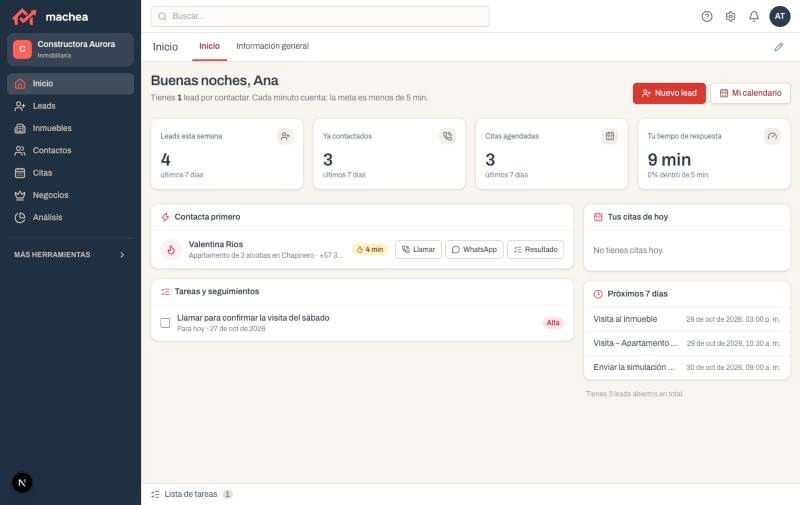

# 07 · Prototipo

## Hipótesis del prototipo

| | |
|---|---|
| **Qué vamos a construir** | Un panel web (CRM) para que los asesores de una constructora o inmobiliaria atiendan rápido los leads que llegan por formularios y por las llamadas de nuestra asistente de voz. Cada lead nuevo aparece con un reloj de respuesta y botones para contactarlo al instante. |
| **Problema que ataca** | Hoy el asesor contacta tarde a los interesados que dejan sus datos y sin saber qué necesitan; el lead se enfría y se pierde. |
| **Cómo se atiende hoy** | Por confirmar en la entrevista: asesores con WhatsApp personal y un CRM, sin saber cuánto tardan en responder. |
| **Tipo de prototipo** | Página web |
| **Tecnología candidata** | Supabase (base de datos), Dapta AI (llamadas de voz) y un modelo de IA; el panel es una página web. |
| **Usuario** | Asesor comercial (y su gerente) |

**Hipótesis**

> Creemos que el asesor comercial podrá dejar de perder leads por responderles tarde si usa una página donde ve cada lead nuevo con un reloj de respuesta y lo contacta con un clic.

**Por qué 5 minutos:** un estudio de Harvard Business Review (Oldroyd, McElheran y Elkington, 2011) encontró que contactar a un lead en la primera hora lo hace casi siete veces más probable de calificar que esperar más. Cinco minutos es una meta más exigente que ese umbral y es fácil de medir.

**Supuestos que queremos validar:**
- El asesor usará el panel en lugar de su WhatsApp personal.
- Hay suficientes asesores disponibles para atender cada lead en 5 minutos.
- El aviso de asignación le llega al asesor a tiempo, sin que tenga que estar mirando el panel.

**Sabremos que es cierto si:** en una semana de prueba al menos 8 de cada 10 leads nuevos se contactan en menos de 5 minutos.

- **Qué cuenta como «contactado»:** el asesor hace clic en Llamar o WhatsApp y el panel registra la hora.
- **Cómo se mide:** tiempo entre la llegada del lead y ese primer clic. El reloj solo corre en horario permitido para contacto comercial (lunes a viernes de 7:00 a 19:00 y sábados de 8:00 a 15:00).
- **La prueba:** 7 días, con 2 o más asesores y al menos 20 leads. Si aún no hay leads reales de un piloto, se usan leads de prueba enviados por el equipo, y el resultado dirá cuál fue el caso.
- **Indicadores de apoyo:** tiempo mediano de respuesta, porcentaje de leads contactados en la semana y leads que llevan más de 15 minutos esperando.
- **Línea base:** [dato por confirmar en la entrevista con la inmobiliaria].
- **Si no se cumple:** revisar si falló el panel (avisos, botones) o la carga de leads por asesor, y ajustar la v0.2.

## Versión 0.1

**Qué tiene la v0.1:**
1. Pantalla «Mi día» del asesor: sus leads nuevos por contactar, con el tiempo que llevan esperando y los botones Llamar, WhatsApp y Registrar resultado. El reloj de cada lead cuenta desde su llegada y se detiene cuando el asesor hace clic en Llamar o WhatsApp.
2. Reparto automático: cada lead nuevo se asigna por turnos al siguiente asesor, que recibe un aviso. Cada lead queda con un solo asesor, para que nadie contacte dos veces al mismo interesado.
3. Panel del gerente: porcentaje de leads contactados a tiempo, tiempo de respuesta del equipo y leads que siguen esperando. Se actualiza con cada contacto registrado, para ver quién va atrasado antes de que el lead se enfríe.

**Ideas para la v0.2:** reasignar el lead si el asesor no responde a tiempo, mostrar el perfil y la cuota estimada del interesado en cada tarjeta, y conectar el panel con el CRM que ya use el cliente.

**Evidencia:**

Captura del prototipo v0.1.

