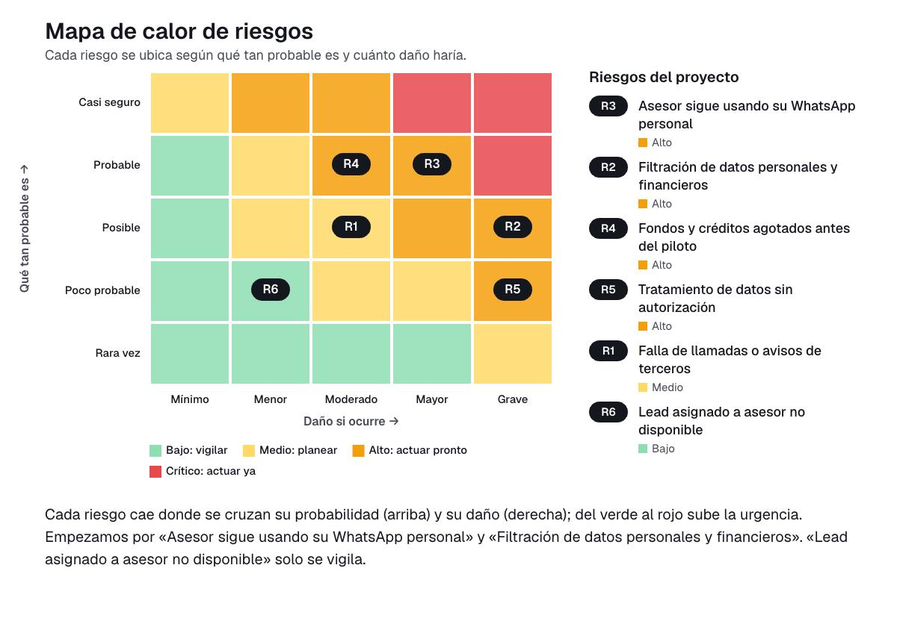

# 09 · Gestión de riesgos

Identificamos y evaluamos los riesgos de implementar Machea en una constructora o inmobiliaria. La solución es un formulario interactivo con IA, un agente de voz y un panel para asesores y gerentes. Cada riesgo se valora con probabilidad (1-5) × impacto (1-5), y el nivel resultante se clasifica así: 1-4 bajo, 5-9 medio, 10-16 alto y 20-25 crítico.

## Matriz de riesgos

| ID | Riesgo | Categoría | P | I | Nivel | Tratamiento | Acción | Responsable | Fecha |
|---|---|---|---|---|---|---|---|---|---|
| R1 | Falla de llamadas o avisos de terceros: las herramientas externas (Dapta, Supabase, Render, Vercel) se caen y el lead no recibe llamada o el asesor no recibe aviso. | Tecnológico | 3 | 3 | 9 (Medio) | Mitigar | Definir un respaldo manual: si la llamada o el aviso fallan, el lead aparece igual en «Mi día» con su reloj. Probar ese flujo con leads de prueba antes del piloto. | AP | 11 de noviembre |
| R2 | Filtración de datos personales y financieros: acceso indebido a contactos, ingresos, cuota estimada o grabaciones de llamadas. | Datos y ciberseguridad | 3 | 5 | 15 (Alto) | Mitigar | Aplicar acceso por roles en Supabase (cada asesor ve solo sus leads), cifrar la información, guardar las claves fuera del código y limitar el acceso a las grabaciones al gerente. | AP | 12 de noviembre |
| R3 | Asesor sigue usando su WhatsApp personal en lugar del panel, y el tiempo de respuesta deja de medirse. | Personas y adopción | 4 | 4 | 16 (Alto) | Mitigar | Hacer una inducción corta con los asesores, ofrecer el panel desde el celular con el botón de WhatsApp incluido y revisar el uso diario en la semana de prueba. | UX | 10 de noviembre |
| R4 | Fondos y créditos agotados antes del piloto: no hay presupuesto asignado y los COP 50 millones solicitados a inversionistas aún no están disponibles. | Financiero | 4 | 3 | 12 (Alto) | Mitigar | Trabajar con planes gratuitos o de bajo costo pagados por los socios, fijar un tope de llamadas por día, llamar solo a leads calificados y llevar un control semanal de gasto. | LP | 7 de noviembre |
| R5 | Tratamiento de datos sin autorización: recoger datos o grabar llamadas sin el consentimiento exigido por la Ley 1581 de 2012. | Legal (Ley 1581 de 2012) | 2 | 5 | 10 (Alto) | Evitar | Incluir en el formulario la autorización previa e informada con la finalidad del tratamiento, avisar al inicio de la llamada que se graba, publicar la política de tratamiento y atender solicitudes de consulta o supresión. | PR | 5 de noviembre |
| R6 | Lead asignado a asesor no disponible: el reparto por turnos le entrega un lead a quien está ausente o fuera de horario. | Operativo | 2 | 2 | 4 (Bajo) | Aceptar | Aceptar el riesgo y vigilarlo con el panel del gerente, que muestra los leads que llevan más de 15 minutos esperando, para reasignarlos a mano si hace falta. | PR | 14 de noviembre |

## Riesgos altos y críticos

No identificamos riesgos críticos. Cuatro riesgos quedaron en nivel alto y los atendemos en este orden.

**R3 · Asesor sigue usando su WhatsApp personal (nivel 16).** Es el riesgo más probable y más dañino. Si el asesor no abre el panel, el reloj no corre y no podemos demostrar que se contacta a tiempo. Plan: inducción con los asesores antes de la prueba, panel disponible en celular y computador, WhatsApp integrado en la tarjeta del lead y revisión diaria de uso. Responsable: UX, antes del 10 de noviembre.

**R2 · Filtración de datos personales y financieros (nivel 15).** Manejamos nombre, teléfono, correo, ingresos del hogar, cuota estimada y grabaciones de llamadas. Plan: acceso por roles, cifrado, claves protegidas y grabaciones visibles solo para el gerente. Responsable: AP, antes del 12 de noviembre.

**R4 · Fondos y créditos agotados antes del piloto (nivel 12).** Construimos sin presupuesto asignado y con créditos limitados. Plan: tope diario de llamadas, llamadas solo a leads calificados, planes gratuitos y control semanal del gasto. Responsable: LP, antes del 7 de noviembre.

**R5 · Tratamiento de datos sin autorización (nivel 10).** Es poco probable si actuamos a tiempo, pero su impacto es grave. Plan: autorización previa en el formulario, aviso de grabación al inicio de cada llamada, política de tratamiento publicada y respeto del horario de contacto comercial. Responsable: PR, antes del 5 de noviembre.

### Cómo leer el mapa de calor

Cada riesgo aparece en la casilla donde se cruzan qué tan probable es (de abajo hacia arriba) y cuánto daño haría si ocurre (de izquierda a derecha), y el color va del verde, que es tranquilidad, al rojo, que es urgencia. En nuestro proyecto lo más arriba y a la derecha quedó «Asesor sigue usando su WhatsApp personal», seguido de «Filtración de datos personales y financieros» y «Fondos y créditos agotados antes del piloto». Preocupan porque toda la propuesta de valor depende de que el asesor use el panel, de que los datos financieros de los interesados estén protegidos y de que tengamos recursos para llegar al piloto, así que empezamos por la inducción a los asesores y por el control de accesos a los datos. «Tratamiento de datos sin autorización» queda alto por su impacto, aunque es poco probable, y lo resolvemos pronto con la autorización en el formulario y el aviso de grabación. «Falla de llamadas o avisos de terceros» queda en zona media y lo cubrimos con un respaldo manual. «Lead asignado a asesor no disponible» quedó en verde porque el gerente lo ve en el panel y puede reasignar el lead, así que basta con vigilarlo.

## Conclusión

Los riesgos más importantes de Machea están en la adopción por parte de los asesores y en la protección de los datos de los interesados, y ambos tienen acciones con responsable y fecha antes del 18 de noviembre.
Con esas acciones y el control semanal del gasto, llegamos a la semana de prueba con un nivel de riesgo manejable.
